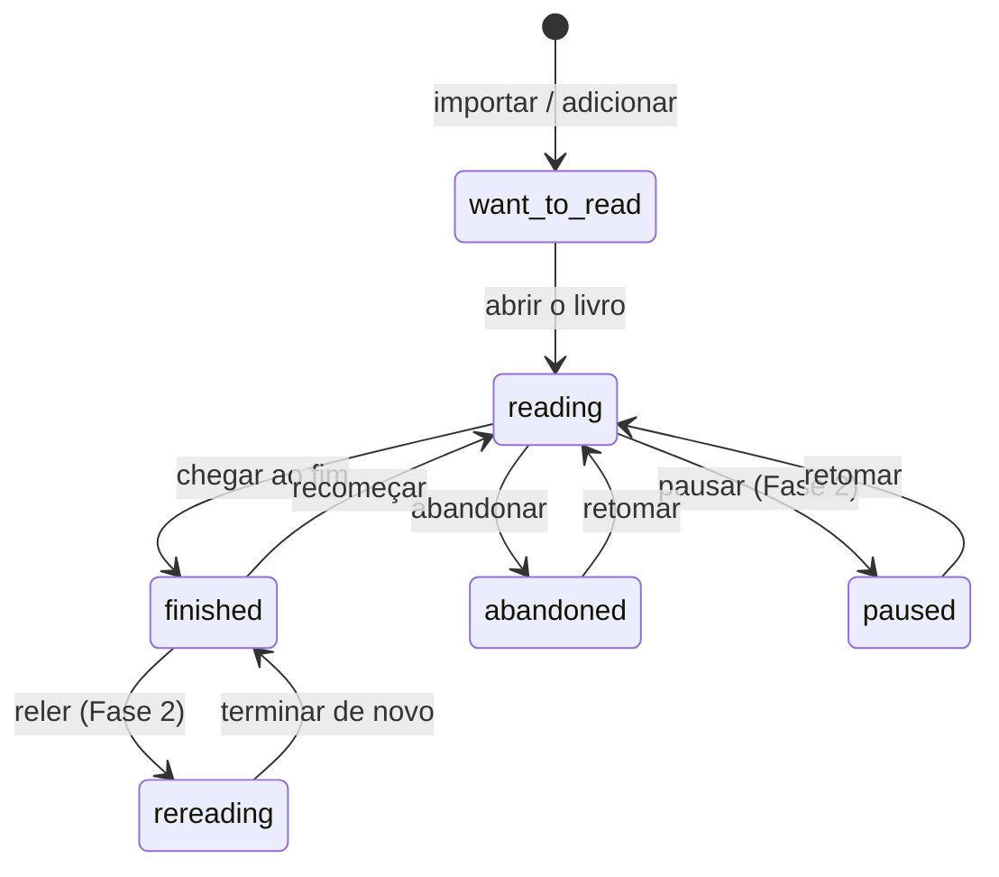

# Spec — Biblioteca pessoal e acompanhamento de leitura

**Status:** aprovada para implementação (decisões fechadas em 22/10/2026)  
**Data:** 21/10/2026, revisada em 22/10/2026 contra o código em produção  
**Público:** produto, engenharia e curadoria  
**Repositórios envolvidos:** `story-magic` (web) e `story-verse-api` (API/banco)  
**Documentos relacionados:** [ARQUITETURA.md](ARQUITETURA.md), [PLANO_NEGOCIO_FEATURES_IA.md](PLANO_NEGOCIO_FEATURES_IA.md), [SPEC_PACOTES_MENSAGENS.md](SPEC_PACOTES_MENSAGENS.md)

---

## 0. Como usar este documento

1. Leia as seções 1 a 5 para alinhar **produto e escopo**.
2. Veja as **decisões** da seção 18 (fechadas em 22/10/2026) antes de começar o banco.
3. Implemente na ordem da seção 17: migração, API, cliente web, telas, migração de dados.
4. Use os critérios de aceite da seção 5 e os testes da seção 15 como definição de pronto.

O Storyverse já está em produção: "Fase 1" é a **primeira entrega da estante**, não um MVP do produto. A recomendação é liberá-la por conta pelo feature-gate (`feature_access`, capability `library`), sem mexer no leitor, na economia de diamantes ou no acervo da comunidade. O chat continua como está e só passa a receber o status e a nota do livro atual (D6).

---

## 1. Resumo executivo

O Storyverse já tem a parte mais difícil de uma biblioteca pessoal: leitor, progresso por capítulo, tempo de leitura, sequência, livros terminados, destaques, conversas com personagens, conquistas, ranking, presentes e sincronização entre aparelhos.

O que falta é a **camada que dá sentido a tudo isso**: uma estante que registre a relação do leitor com cada livro — status, nota, resenha curta, datas, motivo de abandono, notas e coleções. Hoje esses sinais existem de forma fragmentada (`reading-progress`, `finished-books`, `highlights`) e sem modelo no servidor.

A tese deste documento:

> O catálogo é commodity. O histórico da leitura é o ativo. A biblioteca pessoal deve ser o **registro longitudinal** dessa relação, alimentando o chat, a gamificação, o fórum e a descoberta — com o mínimo de trabalho manual para o leitor.

O ganho principal não é "gerenciar livros". É fazer o usuário acumular algo que ele não quer perder: **o que leu, quando, como, o que achou e o que quer ler depois**.

---

## 2. Situação atual

### 2.1 O que já existe

| Área | Onde está | O que já entrega |
|---|---|---|
| Progresso | `src/lib/progress.ts` | Capítulo, rolagem e livro para reabrir; guarda os 30 mais recentes |
| Terminados | `src/lib/finished.ts` | Marca o livro ao chegar ao fim, com `finishedAt` |
| Tempo e sequência | `src/lib/readingStats.ts` | Segundos por dia, meta, sequência, escudos, totais |
| Destaques | `src/lib/highlights.ts` | Trechos por livro, com capítulo, parágrafo e data |
| Conversas | `src/lib/chatHistory.ts` | Histórico por personagem, limitado por livro |
| Conquistas | `src/lib/achievements.ts` | 11 regras calculadas com dados locais |
| Perfil | `ProfilePage` em `src/App.tsx` | "Lendo", "Terminados", "Seus livros", destaques, conquistas, presentes |
| Sincronização | `src/lib/cloudSync.ts` + `reading_state` | Snapshot JSON com merge em 3 vias |
| Gamificação | `src/lib/diamonds.ts`, `src/lib/ranking.ts` | Meta, roleta, salva-ofensiva, ranking semanal |
| Social | `src/lib/community.ts`, `src/lib/forum.ts` | Acervo da comunidade e fórum por obra |
| IA | `src/lib/ai.ts`, `src/lib/readingContext.ts` | Chat com personagens, contexto do trecho atual, sem spoilers além do trecho |
| Retrospectiva | `src/App.tsx` (retrospectiva do mês) | Dias lidos e livros terminados no mês anterior, na primeira semana do mês |
| Gênero | `Ebook.genre` em `src/data/types.ts` | Gênero curto do acervo (comunidade usa "Da comunidade") |
| Liberação por conta | `feature_access` (V14) + `src/lib/accountFeatures.ts` | Capabilities por usuário; branch `feat/feature-gate`, a entrar antes da estante |

### 2.2 O que falta

- **Status explícito** por livro (`quero ler`, `lendo`, `pausado`, `terminado`, `abandonado`, `relendo`).
- **Nota** (0,5 a 5) e **resenha curta** opcional.
- **Datas** de início e conclusão, com opção de catalogação retroativa.
- **Motivo de abandono** (DNF) e possibilidade de retomar.
- **Notas livres** por livro (os destaques são citações, não anotações).
- **Coleções** criadas pelo leitor.
- **Séries e autores** normalizados para "próximo volume" e páginas de autor.
- **Consulta e filtro** da estante no servidor (hoje é snapshot local).
- **Privacidade explícita**: o que é privado e o que pode virar resenha pública.

### 2.3 Por que o snapshot atual não basta

`reading_state` é um JSON por conta. Ele funciona para sincronizar o aparelho, mas não para:

- filtrar e ordenar a estante no servidor;
- contar quantos terminaram um livro;
- publicar resenhas com moderação;
- ligar fórum, ranking e recomendações por obra;
- aplicar regras de recompensa e limite com segurança;
- migrar ou exportar dados de forma estruturada.

A biblioteca precisa de **tabelas normalizadas** no Postgres, mantendo o cliente **local-first** e o merge otimista que já funciona.

---

## 3. Objetivos e não objetivos

### 3.1 Objetivos

| ID | Objetivo | Como medir |
|---|---|---|
| G1 | Registrar a relação do leitor com cada livro | % de usuários ativos com ao menos 1 entrada |
| G2 | Reduzir o esforço de acompanhamento | Status automático em ≥ 90% das entradas |
| G3 | Aumentar a conclusão de livros | Taxa de livros terminados por usuário |
| G4 | Dar contexto à IA e à gamificação | % de conversas com contexto de estante |
| G5 | Criar base para resenhas e clube do livro | % de terminados com nota/resenha |
| G6 | Preservar dados e confiança | Exportação disponível; zero perda em conflito de sync |

### 3.2 Não objetivos desta fase

- Substituir Calibre/Goodreads ou virar um catálogo completo.
- Armazenar o texto dos livros na estante.
- Copiar o leitor paginado do `book-inventory`.
- Implementar OPDS agora.
- Vender assinatura, diamantes ou pacotes nesta fase.
- Tornar notas pessoais públicas.
- Recompensar cadastro em massa ou criação de entradas falsas.

---

## 4. Personas e histórias de usuário

### 4.1 Personas

- **Leitor casual:** abre clássicos do Gutenberg, lê alguns capítulos, gosta da conversa com personagens. Quer continuar de onde parou e lembrar o que achou.
- **Leitor de série:** acompanha volumes e quer saber o próximo, o que falta e o que já terminou.
- **Leitor social:** gosta de ranking, presentes, clube do livro e resenhas.
- **Power user:** importa EPUB/PDF, organiza coleções, quer exportar e talvez usar KOReader.
- **Curador/admin:** precisa de sinais de qualidade e moderação para resenhas e comunidade.

### 4.2 Histórias de usuário

| ID | História | Critério de aceite |
|---|---|---|
| US1 | Ao abrir um livro pela primeira vez, quero que ele entre na minha estante como "lendo" | Entrada criada automaticamente, sem formulário |
| US2 | Quero continuar de onde parei | A estante mostra "Continuar" com capítulo e percentual |
| US3 | Ao terminar, quero dar uma nota e escrever uma resenha curta | Modal opcional; nota de 0,5 a 5; resenha até 4.000 caracteres |
| US4 | Quero registrar que abandonei e por quê | Status "abandonado" + motivo + nota opcional |
| US5 | Quero ver minha estante por status, autor, série e nota | Filtros e ordenação na tela "Minha estante" |
| US6 | Quero criar coleções ("terror brasileiro", "para o inverno") | Criar, renomear, adicionar/remover livros, ordenar |
| US7 | Quero que tudo apareça no celular e na Web | Sync local-first com resolução de conflito |
| US8 | Quero saber o que li no ano | Retrospectiva com livros, páginas, gêneros e nota média |
| US9 | Quero que o personagem saiba o que eu achei, sem spoiler | Contexto de estante no chat, limitado ao que já foi lido |
| US10 | Quero escolher o que é público | Estante privada por padrão; resenha pública só com opt-in |

---

## 5. Escopo por fase

### 5.1 Fase 1 — Estante (P0)

**Objetivo:** estante útil, sincronizada e integrada ao perfil, sem economia nova.

- Modelo `library_entries` no Postgres com RLS.
- Status: `want_to_read`, `reading`, `finished`, `abandoned`.
- Nota de 0,5 a 5 e resenha curta opcional.
- Datas de início/fim, com catalogação retroativa.
- Motivo de abandono.
- Estante no perfil + tela "Minha estante" com filtros e ordenação.
- Página do livro como hub: status, progresso, nota, resenha, citações, chat, ações.
- Criação automática de entrada ao abrir/terminar.
- Migração dos dados locais existentes.
- Sync local-first com merge e resolução de conflito.
- Snapshot de gênero na entrada; filtros por gênero, ano (de `finished_on`) e "possui arquivo" (calculado no cliente).
- Conquistas novas calculadas a partir da estante, incluindo `genres-3` (sem diamantes novos).
- Chat com personagens recebe status e nota do livro atual (D6).
- Liberação por conta pelo feature-gate (capability `library`).

**Fora da Fase 1:** coleções, notas livres, resenhas públicas, séries/autores, recomendações, diamantes por marco, retrospectiva anual.

### 5.2 Fase 2 — Profundidade (P1)

- Coleções e ordenação manual.
- Notas livres por livro e por trecho.
- Resenhas públicas com moderação e opt-in.
- Séries e autores normalizados; "próximo volume".
- Clube do livro no fórum usando `book_key`.
- Recompensas de diamantes por marcos (com validação no servidor).
- Exportação CSV/Markdown.
- Retrospectiva anual.

### 5.3 Fase 3 — Descoberta e interoperabilidade (P2)

- Recomendações por nota, gênero, abandono e série.
- "Quem leu também leu" e estante pública opcional.
- OPDS e integração com KOReader/Thorium.
- Metadados multi-fonte com revisão de conflitos (Open Library, Google Books, Wikidata).
- Deduplicação por ISBN/título/autor para importados.

### 5.4 Prioridade e esforço

| Item | Valor | Esforço | Fase |
|---|---|---|---|
| `library_entries` + API + RLS | Alto | Médio | 1 |
| Status automático + página do livro | Alto | Médio | 1 |
| Nota/resenha + datas + DNF | Alto | Baixo | 1 |
| Sync local-first | Alto | Médio | 1 |
| Migração dos dados locais | Alto | Baixo | 1 |
| Conquistas novas | Médio | Baixo | 1 |
| Coleções | Médio | Médio | 2 |
| Notas livres | Médio | Médio | 2 |
| Resenhas públicas/moderação | Alto | Alto | 2 |
| Séries/autores | Alto | Médio | 2 |
| Clube do livro | Alto | Baixo | 2 |
| Diamantes por marco | Médio | Alto | 2 |
| Recomendações/retrospectiva | Médio | Médio | 3 |
| OPDS/exportação | Médio | Médio | 3 |

---

## 6. Experiência do usuário

### 6.1 Princípios

1. **Tracking invisível:** o status nasce do comportamento (abrir, ler, terminar). O usuário só responde quando agrega.
2. **Divulgação progressiva:** a estante mostra o essencial; nota, resenha, coleções e notas aparecem sob demanda.
3. **Privado por padrão:** nenhuma nota, resenha ou estante é pública sem escolha explícita.
4. **Sem catálogo obrigatório:** o Gutenberg entra sozinho; importados entram ao serem importados.
5. **Offline primeiro:** a estante funciona sem internet e sincroniza depois.

### 6.2 Fluxos principais

#### Abrir um livro pela primeira vez

1. O leitor abre um livro do Gutenberg, da comunidade ou importado.
2. Se não existe entrada, cria `reading` com `started_on = hoje` e `progress_percent = 0`.
3. A página do livro passa a mostrar "Lendo" e "Continuar".
4. Nenhum modal é exibido.

#### Terminar um livro

1. Ao chegar ao último capítulo, o app chama `markBookFinished` (já existe).
2. Abre um modal curto e opcional:
   - "Você terminou. Que nota dá?" (0,5 a 5, com opção "Agora não").
   - Campo de resenha curta (opcional).
   - Botão "Compartilhar" (card existente) e "Próximo da série" (Fase 2).
3. Se o usuário avaliar, o personagem pode reagir em uma fala curta (Fase 2, opcional).
4. A conquista correspondente é atualizada.

#### Abandonar um livro

1. O leitor toca em "Abandonar" na página do livro.
2. Escolhe um motivo: `ritmo lento`, `não era para mim`, `difícil`, `outro`.
3. Pode escrever uma nota curta e escolher "Quero retomar depois".
4. Status vira `abandoned`; a estante mostra o motivo; "retomar" volta para `reading`.

#### Editar a estante

1. "Minha estante" lista os livros com capa, título, autor, status, nota e progresso.
2. Filtros: status, autor, série, gênero, nota, ano, possui arquivo.
3. Ordenação: recentes, título, autor, nota, data de conclusão.
4. Ações rápidas no card: mudar status, dar nota, abrir, remover da estante.

#### Retrospectiva

1. "Seu ano em livros": total, páginas, gêneros, nota média, sequência, melhores notas, abandonados. Estende a retrospectiva do mês que já existe em `App.tsx`, em vez de criar outra.
2. Compartilhável como imagem (Fase 2/3).

### 6.3 Mapa de telas

| Tela | Onde entra | Conteúdo |
|---|---|---|
| Minha estante | Nova aba/seção no perfil | Lista, filtros, ordenação, ações rápidas |
| Página do livro | Ficha existente do livro | Status, progresso, nota, resenha, citações, personagens, chat, ações |
| Modal de conclusão | Ao terminar | Nota, resenha, compartilhar, próximo |
| Modal de abandono | Ação "Abandonar" | Motivo, nota, retomar depois |
| Coleção | Fase 2 | Lista ordenada, adicionar/remover |
| Retrospectiva | Perfil | Números do ano e cards |

### 6.4 Máquina de estados



Regras:

- `finished` só é definido pelo evento de fim de leitura ou ação explícita.
- `abandoned` exige motivo.
- `want_to_read` não conta como livro lido.
- `reading` não sobrescreve `finished` sem ação explícita do usuário.
- `progress_percent` é derivado do leitor; a estante não é a fonte da posição.

---

## 7. Modelo de dados

### 7.1 Identidade do livro

Hoje o `Ebook.id` mistura três origens:

| Origem | Formato atual | `book_key` proposto |
|---|---|---|
| Gutenberg | `gb-<número>` | `gb:<número>` |
| Comunidade | `cm-<uuid>` | `cm:<uuid>` |
| Importado local | número negativo | `local:<número>` |

Regras:

- `book_key` é a chave estável usada na estante, nas notas e nas coleções.
- `local:` é **privado**: não pode aparecer em fórum, resenha pública ou ranking.
- O fórum já aceita `gb:` e `cm:`; não é necessário alterar a regex na Fase 1.
- `local:` usa o id do livro importado (`newLocalBookId` em `localBooks.ts`: timestamp × 1000 + aleatório), que é o mesmo em todos os aparelhos da conta.
- Deduplicação entre origens é Fase 3.

### 7.2 Tabelas

#### `public.library_entries`

Uma linha por `(user_id, book_key)`.

```sql
create table if not exists public.library_entries (
  user_id uuid not null references auth.users (id) on delete cascade,
  book_key text not null check (book_key ~ '^(gb:[0-9]+|cm:[0-9a-fA-F-]{36}|local:-?[0-9]+)$'),
  source text not null check (source in ('gutenberg', 'community', 'local')),
  status text not null default 'want_to_read'
    check (status in ('want_to_read', 'reading', 'finished', 'abandoned')),
  rating numeric(2,1) check (rating is null or (rating between 0.5 and 5 and rating * 2 = floor(rating * 2))),
  review text check (review is null or char_length(review) <= 4000),
  started_on date,
  finished_on date,
  dnf_reason text check (dnf_reason is null or dnf_reason in ('slow', 'not_for_me', 'difficult', 'other')),
  dnf_note text check (dnf_note is null or char_length(dnf_note) <= 500),
  progress_percent smallint check (progress_percent is null or progress_percent between 0 and 100),
  progress_label text check (progress_label is null or char_length(progress_label) <= 200),
  -- Snapshot de exibição/exportação; a fonte canônica de metadados vem depois.
  title text not null check (char_length(title) between 1 and 300),
  author text check (author is null or char_length(author) <= 300),
  cover_url text check (cover_url is null or char_length(cover_url) <= 500),
  series text check (series is null or char_length(series) <= 200),
  series_index numeric(6,2),
  genre text check (genre is null or char_length(genre) <= 80),
  language text check (language is null or language in ('pt', 'en')),
  created_at timestamptz not null default now(),
  updated_at timestamptz not null default now(),
  deleted_at timestamptz,
  version integer not null default 1,
  primary key (user_id, book_key)
);

create index if not exists library_entries_user_updated_idx
  on public.library_entries (user_id, updated_at desc)
  where deleted_at is null;

create index if not exists library_entries_user_status_idx
  on public.library_entries (user_id, status, updated_at desc)
  where deleted_at is null;

create index if not exists library_entries_user_author_idx
  on public.library_entries (user_id, lower(author))
  where deleted_at is null;

create index if not exists library_entries_user_series_idx
  on public.library_entries (user_id, lower(series), series_index)
  where deleted_at is null;
```

Observações:

- `progress_percent` e `progress_label` são **resumo para a estante**. A posição fina continua no snapshot `reading_state` e em `src/lib/progress.ts` (capítulo + rolagem), para não duplicar o leitor.
- `title`, `author`, `cover_url` etc. são snapshot. Na Fase 2, um `book_catalog` normaliza autores e séries.
- `genre` copia `Ebook.genre`. "Da comunidade" não conta como gênero (filtros e `genres-3`); importados ficam sem gênero.
- Ano é derivado de `finished_on`; "possui arquivo" é calculado no cliente (o livro ainda abre neste aparelho/conta), sem coluna.
- Na Fase 1 tudo é privado (D3/D10): não há coluna de visibilidade. A estante pública e as resenhas públicas entram na Fase 2, com coluna, políticas e moderação próprias.

#### `public.library_notes` (Fase 2)

```sql
create table if not exists public.library_notes (
  id uuid primary key default gen_random_uuid(),
  user_id uuid not null references auth.users (id) on delete cascade,
  book_key text not null,
  kind text not null default 'note' check (kind in ('note', 'quote')),
  chapter_ref text check (chapter_ref is null or char_length(chapter_ref) <= 200),
  paragraph_ref integer,
  body text not null check (char_length(body) between 1 and 4000),
  created_at timestamptz not null default now(),
  updated_at timestamptz not null default now(),
  deleted_at timestamptz
);
```

#### `public.library_collections` e `public.library_collection_books` (Fase 2)

```sql
create table if not exists public.library_collections (
  id uuid primary key default gen_random_uuid(),
  user_id uuid not null references auth.users (id) on delete cascade,
  name text not null check (char_length(name) between 1 and 80),
  description text check (description is null or char_length(description) <= 500),
  is_public boolean not null default false,
  created_at timestamptz not null default now(),
  updated_at timestamptz not null default now(),
  deleted_at timestamptz,
  unique (user_id, lower(name))
);

create table if not exists public.library_collection_books (
  collection_id uuid not null references public.library_collections (id) on delete cascade,
  book_key text not null,
  position integer not null default 0,
  added_at timestamptz not null default now(),
  primary key (collection_id, book_key)
);
```

Limites sugeridos: 100 coleções por conta, 500 livros por coleção.

#### `public.library_reviews` (Fase 2)

Separar resenha pública de `library_entries` evita vazar notas privadas por acidente e permite moderação:

```sql
create table if not exists public.library_reviews (
  id uuid primary key default gen_random_uuid(),
  user_id uuid not null references auth.users (id) on delete cascade,
  book_key text not null check (book_key ~ '^(gb:[0-9]+|cm:[0-9a-fA-F-]{36})$'),
  rating numeric(2,1) not null check (rating between 0.5 and 5 and rating * 2 = floor(rating * 2)),
  body text not null check (char_length(body) between 1 and 4000),
  status text not null default 'pending' check (status in ('pending', 'published', 'hidden', 'deleted')),
  created_at timestamptz not null default now(),
  updated_at timestamptz not null default now(),
  unique (user_id, book_key)
);
```

### 7.3 RLS e permissões

Padrão do projeto: RLS habilitada, runtime com papel `storyverse_api`, `DbSession.setUser` definindo `app.user_id`, políticas usando `auth.uid()`.

```sql
alter table public.library_entries enable row level security;

create policy "cada um ve sua estante"
  on public.library_entries for select
  using (user_id = auth.uid() and deleted_at is null);

create policy "cada um cria sua estante"
  on public.library_entries for insert
  with check (user_id = auth.uid());

create policy "cada um atualiza sua estante"
  on public.library_entries for update
  using (user_id = auth.uid())
  with check (user_id = auth.uid());

create policy "cada um apaga sua estante"
  on public.library_entries for delete
  using (user_id = auth.uid());

grant select, insert, update, delete on public.library_entries to authenticated;
```

Para a estante pública (Fase 2), adicionar política de leitura separada, com campos públicos explícitos. Não expor `review`, `dnf_note` ou notas na mesma linha pública.

### 7.4 Migração

Arquivo sugerido: `story-verse-api/src/main/resources/db/migration/V15__library.sql` (a V14 é a `V14__feature_access.sql` do feature-gate, que precisa entrar antes).

Ordem:

1. Criar `library_entries`.
2. Criar índices.
3. Habilitar RLS e políticas.
4. Conceder privilégios ao papel `authenticated`.
5. (Fase 2) Criar `library_notes`, `library_collections`, `library_collection_books`, `library_reviews`.

Não alterar `reading_state` nem `book_submissions` na Fase 1.

---

## 8. API (story-verse-api)

### 8.1 Convenções

- Autenticação: `Authorization: Bearer <accessToken>`.
- `user_id` sempre vem do token, nunca do corpo.
- JSON em camelCase na API, `snake_case` no banco (conversão no repositório).
- Erros no formato existente: `{ "error": "mensagem" }`.
- Paginação por cursor (`updatedAt`, `bookKey`).
- Concorrência otimista: `baseUpdatedAt` (mesmo padrão de `reading-state`).
- Operações idempotentes por `PUT` e por `clientId` em notas/coleções.

### 8.2 Endpoints da Fase 1

| Método | Rota | Função |
|---|---|---|
| `GET` | `/api/v1/me/library` | Lista a estante, com filtros e paginação |
| `GET` | `/api/v1/me/library/{bookKey}` | Detalhe de uma entrada |
| `PUT` | `/api/v1/me/library/{bookKey}` | Cria ou substitui a entrada (upsert idempotente) |
| `PATCH` | `/api/v1/me/library/{bookKey}` | Atualização parcial com concorrência otimista |
| `DELETE` | `/api/v1/me/library/{bookKey}` | Remove da estante (soft delete) |
| `POST` | `/api/v1/me/library/{bookKey}/finish` | Marca terminado, com nota/resenha opcionais |
| `POST` | `/api/v1/me/library/{bookKey}/abandon` | Marca abandonado, com motivo |
| `GET` | `/api/v1/me/library/stats?year=2026` | Totais e retrospectiva |

#### `GET /api/v1/me/library`

Query params:

- `status` (repetível ou CSV)
- `author`, `series`, `language`
- `minRating`, `maxRating`
- `sort` (`recent`, `title`, `author`, `rating`, `finished`)
- `cursor`, `limit` (máx. 100)

Resposta:

```json
{
  "items": [
    {
      "bookKey": "gb:1234",
      "source": "gutenberg",
      "title": "Dom Casmurro",
      "author": "Machado de Assis",
      "coverUrl": null,
      "status": "finished",
      "rating": 4.5,
      "review": "Leitura densa, mas indispensável.",
      "startedOn": "2026-09-01",
      "finishedOn": "2026-09-20",
      "dnfReason": null,
      "dnfNote": null,
      "progressPercent": 100,
      "progressLabel": "Capítulo 148",
      "genre": "Romance",
      "updatedAt": "2026-09-20T18:12:00Z",
      "version": 3
    }
  ],
  "nextCursor": null
}
```

#### `PUT /api/v1/me/library/{bookKey}`

Corpo:

```json
{
  "source": "gutenberg",
  "status": "reading",
  "title": "Dom Casmurro",
  "author": "Machado de Assis",
  "coverUrl": null,
  "series": null,
  "seriesIndex": null,
  "genre": "Romance",
  "language": "pt",
  "startedOn": "2026-09-01",
  "progressPercent": 42,
  "progressLabel": "Capítulo 62",
  "baseUpdatedAt": null
}
```

Regras:

- `bookKey` da rota é a fonte da verdade; o corpo não pode alterá-lo.
- `source` e `title` obrigatórios na criação.
- `status = abandoned` exige `dnfReason`.
- `status = finished` exige `finishedOn` (ou o servidor preenche com hoje).
- `startedOn` não pode ser posterior a `finishedOn`.
- `rating` só é aceita se `status = finished` ou `rereading` (Fase 2); na Fase 1, aceitar em `finished`.
- `review` é opcional e independente da nota na Fase 1 (fica privada). Na Fase 2, publicar resenha exige nota e opt-in.
- Retorno `409` se `baseUpdatedAt` não corresponder ao `updated_at` atual; devolver a entrada atual.

#### `POST /api/v1/me/library/{bookKey}/finish`

Corpo:

```json
{
  "finishedOn": "2026-09-20",
  "rating": 4.5,
  "review": "Leitura densa, mas indispensável."
}
```

Regras:

- Idempotente: se já estiver `finished`, atualiza nota/resenha sem duplicar conquista.
- Se `finishedOn` for anterior a `startedOn`, ajustar `startedOn` para a mesma data ou rejeitar com `422`.
- Não concede diamantes na Fase 1.

#### `POST /api/v1/me/library/{bookKey}/abandon`

```json
{
  "dnfReason": "not_for_me",
  "dnfNote": "O ritmo não me pegou.",
  "keepForLater": true
}
```

`keepForLater = true` mantém a entrada com status `abandoned`; o cliente oferece "retomar" depois.

#### `DELETE /api/v1/me/library/{bookKey}`

- Soft delete (`deleted_at`) para preservar histórico e sincronizar a remoção.
- Não apaga o livro do acervo, o arquivo, as notas ou as conversas.

### 8.3 Endpoints da Fase 2

- `GET/POST/PATCH/DELETE /api/v1/me/library/{bookKey}/notes`
- `GET/POST/PATCH/DELETE /api/v1/me/collections`
- `POST/DELETE /api/v1/me/collections/{id}/books/{bookKey}`
- `GET /api/v1/library/books/{bookKey}/reviews?cursor=`
- `POST /api/v1/library/books/{bookKey}/reviews`
- `PATCH /api/v1/admin/library/reviews/{id}` (moderação)
- `GET /api/v1/me/library/export?format=csv|md`

### 8.4 Erros e limites

| Código | Quando |
|---|---|
| `400` | Corpo inválido, `bookKey` inválido, campo obrigatório ausente |
| `401` | Sem token ou token expirado |
| `403` | Tentando acessar entrada de outra conta ou `local:` em rota pública |
| `404` | Entrada/livro não encontrado |
| `409` | Conflito de `baseUpdatedAt` |
| `422` | Regra de negócio (datas incoerentes, nota fora da faixa) |
| `429` | Limite de frequência |

Limites sugeridos:

- `PATCH`/`PUT`: 60 por minuto por conta.
- Notas: 30 por minuto; 500 por dia.
- Resenhas públicas: 5 por dia; conta com pelo menos 1 dia.
- Coleções: 10 por dia.
- Exportação: 1 por hora.

Usar `RateLimits`/`api_rate_limits` já existentes.

### 8.5 Recompensas e validação

O servidor **não** deve confiar no cliente para conceder diamantes. Na Fase 1:

- Nenhuma recompensa nova.
- Conquistas são calculadas localmente (como hoje) ou no cliente a partir da estante.

Na Fase 2:

- Recompensa por "primeira resenha de um livro" só depois de existir validação mínima (conta com idade, limite diário, uma vez por `book_key`).
- Recompensa por "livro terminado" exige sinal de leitura por livro. Hoje o servidor só tem minutos agregados (`reading_clock`, `report_reading`); será necessário adicionar progresso por livro ou aceitar o risco com limites.
- Nunca pagar por criar entrada, importar ou cadastrar livro.

---

## 9. Frontend (story-magic)

### 9.1 Módulos novos

| Arquivo | Responsabilidade |
|---|---|
| `src/lib/library.ts` | Tipos (`ShelfEntry`), `bookKey`, cliente da API, regras de status |
| `src/lib/libraryStore.ts` | Cache local (localStorage/IndexedDB), fila offline, tombstones |
| `src/lib/librarySync.ts` | Pull/push, merge e resolução de conflito |
| `src/features/library/LibraryPage.tsx` | Tela "Minha estante" |
| `src/features/library/BookShelf.tsx` | Lista/grid, filtros e ordenação |
| `src/features/library/BookStatusControl.tsx` | Mudança de status e ações rápidas |
| `src/features/library/RatingStars.tsx` | Nota de 0,5 em 0,5 |
| `src/features/library/FinishBookDialog.tsx` | Conclusão com nota/resenha |
| `src/features/library/AbandonBookDialog.tsx` | Motivo e nota |
| `src/features/library/NotesPanel.tsx` | Notas e citações (Fase 2) |
| `src/features/library/YearRecap.tsx` | Retrospectiva (Fase 2/3) |

O `App.tsx` é grande; extrair esses componentes reduz risco e facilita teste.

### 9.2 Chaves locais

| Chave | Conteúdo |
|---|---|
| `storyverse:shelf-entries` | Mapa `bookKey -> ShelfEntry` |
| `storyverse:shelf-notes` | Mapa `bookKey -> Note[]` (Fase 2) |
| `storyverse:shelf-collections` | Lista de coleções (Fase 2) |
| `storyverse:shelf-tombstones` | Itens removidos, com `deletedAt` |
| `storyverse:shelf-migrated` | Versão da migração local |

O prefixo é `shelf` e o tipo é `ShelfEntry` porque `storyverse:library` e o tipo `LibraryEntry` já existem em `src/lib/localBooks.ts` (lista dos livros importados da conta).

Manter as chaves atuais (`reading-progress`, `finished-books`, `highlights`) intactas. A estante lê delas para a migração e para o "continuar", mas não as substitui na Fase 1.

### 9.3 Sync local-first

Fluxo ao abrir o app com sessão:

1. Ler cache local.
2. `GET /api/v1/me/library` (paginado) e juntar com o local.
3. Resolver conflitos por campo:
   - `status`: vence a intenção mais recente; nunca rebaixar `finished` para `reading` sem ação do usuário.
   - `rating`, `review`, `dnfReason`, `dnfNote`: vence o `updatedAt` mais recente.
   - `progressPercent`: vence o maior, salvo reset explícito.
   - `startedOn`: vence a data mais antiga não nula.
   - `finishedOn`: vence a data mais recente não nula.
   - Remoções: tombstones vencem se mais recentes.
4. Enviar mudanças pendentes (`PUT`/`PATCH`) com `baseUpdatedAt`.
5. Em `409`, baixar a entrada atual, refazer o merge e tentar de novo uma vez.

Offline:

- Toda ação grava local e entra na fila.
- A fila é processada ao voltar a internet, ao voltar para o app e a cada 30 s (mesmo padrão do `cloudSync`).
- Nunca descartar ação local por falha de rede.

### 9.4 Integração com módulos existentes

| Módulo existente | Mudança |
|---|---|
| `progress.ts` | Ao salvar progresso, atualizar `progressPercent` e `progressLabel` na estante (debounce) |
| `finished.ts` | Ao marcar terminado, criar/atualizar `library_entries` com `finished` e abrir o modal |
| `readingStats.ts` | Alimentar retrospectiva e conquistas; não alterar a lógica de sequência |
| `highlights.ts` | Continuar como está; na Fase 2, espelhar como `kind = quote` nas notas |
| `chatHistory.ts` | Sem mudança; a página do livro continua abrindo o chat |
| `achievements.ts` | Adicionar regras de estante (nota, resenha, série, gênero) |
| `cloudSync.ts` | Sincronizar as novas chaves ou delegar ao `librarySync.ts` |
| `ProfilePage` | Adicionar "Minha estante" e o resumo de notas/resenhas |
| `ai.ts` (prompt do chat) | Fase 1: acrescentar status e nota do livro atual (D6). Fase 2: resenha e notas com opt-in |
| `community.ts` | Oferecer "Adicionar à estante" após aprovação/abertura; não auto-adicionar |
| `forum.ts` | Na Fase 2, criar clube do livro usando `book_key` e `spoiler_level` |
| `importBook.ts` | Criar entrada `local:` como `want_to_read` ao importar |

### 9.5 Regras de UI

- O status automático não pergunta nada ao abrir.
- O modal de conclusão só aparece uma vez por livro e pode ser dispensado.
- Nota e resenha são opcionais; "Agora não" não bloqueia a estante.
- O motivo de abandono é obrigatório apenas para `abandoned`.
- A estante privada não mostra dados públicos de outros usuários.
- Resenhas públicas (Fase 2) exigem opt-in explícito e moderação.
- Acessibilidade: estrelas com `aria-label`, foco visível, navegação por teclado.

### 9.6 Liberação por conta (feature-gate)

A estante usa o feature-gate por conta, não uma variável de build:

- A API guarda em `public.feature_access` quem tem a capability `library` (migração V14, branch `feat/feature-gate`). O servidor é a fonte da verdade: as rotas `/api/v1/me/library` respondem `403` para quem não tem.
- O cliente lê as capabilities com `useAccountFeatures` (`src/features/auth/useAccountFeatures.ts`) e só mostra a tela e os modais para quem tem `library`.
- Conceder ou retirar: `deploy/grant-feature.sh` na VPS.

---

## 10. Integração com gamificação e IA

### 10.1 Conquistas

Adicionar em `achievements.ts` (calculadas no cliente, como as 11 atuais):

| ID | Título | Regra |
|---|---|---|
| `first-rating` | "Primeira nota" | 1 livro com nota |
| `ratings-5` | "Crítico iniciante" | 5 livros com nota |
| `first-review` | "Resenha de estreia" | 1 resenha com 200+ caracteres |
| `reviews-3` | "Voz da estante" | 3 resenhas |
| `series-1` | "Colecionador de séries" | 1 série completa (Fase 2) |
| `genres-3` | "Leitor eclético" | 3 gêneros diferentes terminados (sem contar "Da comunidade") |
| `year-10` | "Dez no ano" | 10 livros terminados no ano |

### 10.2 Diamantes

Fase 1: **não** adicionar fontes de diamantes. A economia já está inflacionada (ver `PLANO_NEGOCIO_FEATURES_IA.md`).

Fase 2, se aprovado:

- 1 recompensa por livro terminado, uma vez, com limite diário.
- 1 recompensa por resenha publicada e aprovada, uma vez por livro.
- Bônus por série completa.
- Teto semanal e detecção de padrão anômalo.
- Preferir recompensar **profundidade** (resenha, série) a quantidade de cadastros.

### 10.3 Ranking

- Manter minutos como métrica principal.
- Adicionar selo "terminou N livros" e "resenhas" no perfil.
- Não criar ranking por número de livros cadastrados.
- Não premiar entrada criada sem leitura.

### 10.4 IA

O chat já funciona em produção e continua igual: contexto do trecho atual (`readingContext.ts`), sem spoilers além dele (`ai.ts`), com os limites de tamanho e tokens que já existem. A estante só acrescenta contexto:

- **Fase 1 (D6):** status (lendo, terminado, abandonado) e nota do livro atual. Uma linha curta no prompt, sem custo relevante.
- **Fase 2:** resenha e até 2 notas/destaques do livro atual, só com opt-in da pessoa.
- Nunca dados de outros livros.
- A IA não escreve nem altera a estante; só lê o contexto permitido.

### 10.5 Personagem reagindo à conclusão (Fase 2)

- Uma fala curta, gerada uma vez por livro, após a nota.
- Se a IA estiver indisponível, usar uma frase determinística.
- Não bloquear a conclusão nem a nota por causa da IA.

---

## 11. Integração social

### 11.1 Resenhas

- Privadas por padrão.
- "Publicar resenha" é uma ação explícita.
- Resenha pública exige nota, texto e moderação.
- Não publicar `dnfNote` automaticamente.
- Mostrar no perfil apenas o que o usuário autorizou.

### 11.2 Fórum e clube do livro

O fórum já tem `book_key`, `chapter_ref` e `spoiler_level`. Na Fase 2:

- Criar o espaço "Clube do livro" (já existe como `clube`).
- Ao abrir a página do livro, mostrar "Discussões sobre este livro".
- Tópicos com `spoiler_level = chapter` só aparecem para quem já passou do capítulo.
- `book_key` público aceita `gb:` e `cm:`; `local:` fica de fora.
- Reaproveitar reações, bookmarks, denúncias e moderação existentes.

### 11.3 Comunidade

- Submissão aprovada não entra automaticamente na estante.
- Mostrar "Adicionar à minha estante" na página do livro da comunidade.
- Resenhas da comunidade podem aparecer na página do livro (Fase 2), com moderação.

### 11.4 Presentes e perfil

- Presentes continuam como estão.
- Perfil pode mostrar "livros terminados", "nota média" e "resenhas" (privacidade configurável).
- Não expor notas, DNF ou datas sem opt-in.

---

## 12. Migração e retrocompatibilidade

### 12.1 Backfill local

Na primeira abertura com a capability `library` e sessão ativa:

1. Ler `storyverse:finished-books` e criar entradas `finished` com `finishedOn` derivado de `finishedAt`.
2. Ler `storyverse:reading-progress` e criar entradas `reading` para livros não terminados.
3. Ler `storyverse:highlights:*` e guardar localmente para a Fase 2 (não enviar ao servidor na Fase 1).
4. Marcar `storyverse:shelf-migrated = 1`.
5. Não apagar as chaves antigas.

### 12.2 Dados do servidor

- `reading_state` continua sendo a fonte da posição fina e do snapshot.
- A estante é uma tabela separada, aditiva.
- Merge no primeiro login: se já existir entrada no servidor, preservar a mais recente; se o local for mais rico (nota/resenha), enviar.

### 12.3 Livros importados

- `local:` é privado e não aparece em fórum, ranking ou resenha pública.
- O arquivo continua no `user-books`; a estante guarda apenas metadados e status.
- Se o livro for removido de "Seus livros", a entrada da estante pode permanecer como histórico, com aviso "arquivo removido".

### 12.4 Rollback

- Retirar a capability `library` (`deploy/grant-feature.sh`).
- A API pode continuar no ar; nenhuma migração destrutiva.
- Dados locais permanecem; dados do servidor podem ser exportados depois.

---

## 13. Privacidade e segurança

- Estante, notas e DNF são **privados por padrão**.
- Resenha pública é opt-in e moderada.
- RLS em todas as tabelas; `user_id` sempre do token.
- Notas e resenhas passam por sanitização no cliente e no servidor.
- Exportação e exclusão de conta devem incluir a estante.
- Não registrar conteúdo de notas/resenhas em logs ou telemetria.
- Rate limit em escrita.
- `local:` nunca em rotas públicas.
- Seguir as regras de `docs/RELATORIO_SEGURANCA_WEB_API_2026-10-21.md`.

---

## 14. Métricas e critérios de sucesso

### 14.1 Métricas

- `library_entry_created` (por origem)
- `book_finished`
- `rating_set`
- `review_saved`
- `dnf_set` (com motivo)
- `collection_created`
- `library_sync_conflict`
- `library_sync_error`
- `library_export`
- Tempo até a primeira entrada após abrir um livro
- % de terminados com nota
- % de usuários com ao menos 1 entrada
- Retenção D7/D30 de quem usa a estante vs. quem não usa

### 14.2 Metas sugeridas (4 a 8 semanas após o rollout)

- ≥ 30% dos usuários ativos com ao menos 1 entrada.
- ≥ 50% dos livros terminados com nota.
- ≥ 15% dos terminados com resenha de 200+ caracteres.
- ≥ 90% das entradas com status automático (sem edição manual).
- < 1% de erros de sync por sessão.
- p95 da API de estante < 300 ms.

Ajustar as metas depois do beta; o importante é medir antes de expandir.

---

## 15. Testes

### 15.1 Unitários

- `bookKey` para Gutenberg, comunidade e local.
- Transições de status permitidas e proibidas.
- Validação de nota (0,5 a 5, incremento de 0,5).
- Datas coerentes (`startedOn <= finishedOn`).
- Merge por campo e tombstones.
- Regras de conquistas.

### 15.2 Integração (API)

- RLS: usuário A não lê nem escreve a estante de B.
- `PUT` idempotente.
- `PATCH` com `baseUpdatedAt` correto e conflito `409`.
- `finish` repetido não duplica.
- `abandon` exige motivo.
- `local:` rejeitado em rota pública.
- Paginação e filtros.
- Rate limit.
- Exclusão de conta remove a estante.

### 15.3 Frontend

- Abrir livro cria entrada `reading`.
- Terminar abre o modal uma vez.
- "Agora não" mantém a estante.
- Offline cria entrada local e sincroniza depois.
- Conflito não perde nota/resenha.
- Filtros e ordenação.
- Acessibilidade das estrelas e modais.

### 15.4 Migração

- `finished-books` vira `finished` com data.
- `reading-progress` vira `reading`.
- Destaques permanecem intactos.
- Rodar duas vezes não duplica.

---

## 16. Rollout

Etapas de liberação da Fase 1 (não confundir com as fases de escopo da seção 5):

1. **Infraestrutura:** feature-gate (V14) em produção, depois migração V15, endpoints e testes, sem nenhuma conta com `library`.
2. **Beta interno:** capability `library` para a equipe; monitorar erros, latência e conflitos.
3. **Beta 10%:** conceder a um grupo de leitores ativos.
4. **50%:** se métricas de erro e retenção estiverem saudáveis.
5. **100%:** comunicar no app e no fórum.

Critérios de pausa:

- Erro de sync acima de 2%.
- Perda de dados relatada.
- Aumento de abuso em resenhas.
- Latência acima do orçamento.

Kill switch: retirar a capability `library` de todos (`feature_access.enabled = false`) e, se necessário, desabilitar as rotas.

---

## 17. Plano de implementação

### 17.1 Backend (`story-verse-api`)

- [ ] Garantir que o feature-gate (`V14__feature_access.sql`) já está na `main`.
- [ ] Criar `V15__library.sql` com tabela, índices, RLS e grants.
- [ ] Exigir a capability `library` nas rotas da estante.
- [ ] Criar `LibraryEntry` (record), `LibraryRepository`, `LibraryService`, `LibraryController`.
- [ ] Implementar `GET`, `PUT`, `PATCH`, `DELETE`, `finish`, `abandon`, `stats`.
- [ ] Validar `bookKey`, status, nota, datas e limites.
- [ ] Implementar concorrência com `baseUpdatedAt` e `version`.
- [ ] Adicionar rate limit.
- [ ] Testes de integração e RLS.
- [ ] Documentar endpoints no README da API.

### 17.2 Frontend (`story-magic`)

- [ ] Criar tipos e cliente em `src/lib/library.ts`.
- [ ] Criar store local e fila offline em `src/lib/libraryStore.ts`.
- [ ] Criar sync em `src/lib/librarySync.ts`.
- [ ] Integrar `progress.ts` e `finished.ts`.
- [ ] Criar `LibraryPage`, `BookShelf`, `RatingStars`, modais e `BookStatusControl`.
- [ ] Adicionar "Minha estante" ao perfil e à navegação.
- [ ] Adicionar ações na página do livro.
- [ ] Migrar dados locais existentes.
- [ ] Adicionar conquistas (incluindo `genres-3`).
- [ ] Passar status e nota do livro atual para o prompt do chat.
- [ ] Esconder a estante de quem não tem a capability `library`; testes.
- [ ] Atualizar `docs/ARQUITETURA.md` e `README.md`.

### 17.3 Produto e curadoria

- [ ] Escrever textos de modais, estados vazios e erros.
- [ ] Definir motivos de abandono e copy.
- [ ] Definir política de privacidade e moderação de resenhas.
- [ ] Definir metas e dashboard.
- [ ] Rodar beta com 10 a 20 leitores.

### 17.4 Estimativa indicativa

- Backend (Fase 1): 4 a 6 dias.
- Frontend (Fase 1): 6 a 10 dias.
- Migração e testes: 3 a 4 dias.
- Beta e ajustes: 3 a 5 dias.

Total aproximado: **3 a 4 semanas** com uma pessoa, ou **2 semanas** com duas pessoas em paralelo (backend/frontend).

---

## 18. Decisões

Fechadas em 22/10/2026.

| ID | Pergunta | Decisão |
|---|---|---|
| D1 | Nota de meia estrela? | Sim, 0,5 a 5 |
| D2 | `paused` e `rereading` na Fase 1? | Não; Fase 2 |
| D3 | Resenha pública na Fase 1? | Não; tudo privado na Fase 1 |
| D4 | Resenha em `library_entries` ou tabela separada? | Fase 1: `review` privada na entrada. Fase 2: `library_reviews` para resenhas públicas |
| D5 | Diamantes por conclusão? | Não na Fase 1; Fase 2 com validação e teto |
| D6 | O chat recebe o que a pessoa registrou? | Sim: status e nota do livro atual já na Fase 1. Resenha e notas só com opt-in, na Fase 2. Nunca outros livros |
| D7 | Importados vão para a nuvem? | Sim, como `local:` privado; nunca em fórum/resenha pública |
| D8 | Metadados na Fase 1? | Snapshot de série, autor e gênero na entrada; filtros por gênero, ano e "possui arquivo"; normalização na Fase 2 |
| D9 | Migrar dados locais? | Sim, uma vez, sem apagar as chaves antigas |
| D10 | Estante pública no perfil? | Fase 2, opt-in; sem coluna de visibilidade na Fase 1 |

---

## 19. Riscos e mitigação

| Risco | Impacto | Mitigação |
|---|---|---|
| Virar um Goodreads/Calibre clone | Perda de foco | Não objetivos explícitos; Fase 1 enxuta |
| Exigir catalogação manual | Baixa adoção | Status automático; nota/resenha opcionais |
| Conflito de sync perder dados | Perda de confiança | Merge por campo, tombstones, testes |
| Privacidade de notas | Dano reputacional | Privado por padrão; RLS; opt-in |
| Abuso de recompensas | Economia inflada | Sem diamantes na Fase 1; limites na Fase 2 |
| Custo de IA | Orçamento | Contexto curto, cache, cota existente |
| Identidade de livro inconsistente | Dados duplicados | `book_key` normalizado; dedupe na Fase 3 |
| Performance da estante | Lentidão | Índices, paginação, cache local |
| Moderação de resenhas | Sobrecarga | Fase 2, fila de moderação e denúncias |

---

## 20. Anexos

### 20.1 Dicionário de campos

| Campo | Tipo | Regra |
|---|---|---|
| `book_key` | text | `gb:<n>`, `cm:<uuid>` ou `local:<n>` |
| `source` | text | `gutenberg`, `community`, `local` |
| `status` | text | `want_to_read`, `reading`, `finished`, `abandoned` |
| `rating` | numeric(2,1) | 0,5 a 5, passo 0,5 |
| `review` | text | Até 4.000 caracteres; privada na Fase 1 |
| `started_on` | date | Não pode ser posterior a `finished_on` |
| `finished_on` | date | Preenchida ao concluir |
| `dnf_reason` | text | `slow`, `not_for_me`, `difficult`, `other` |
| `dnf_note` | text | Até 500 caracteres |
| `progress_percent` | smallint | 0 a 100; resumo para a estante |
| `progress_label` | text | Ex.: "Capítulo 62" |
| `genre` | text | Snapshot de `Ebook.genre`, até 80 caracteres; "Da comunidade" não conta como gênero |
| `version` | integer | Incrementa a cada escrita; concorrência |
| `deleted_at` | timestamptz | Soft delete |

### 20.2 Exemplo de merge

```text
Local:  { status: "finished", rating: 4.5, updatedAt: 10:00 }
Servidor: { status: "reading", rating: null, updatedAt: 09:00 }
Resultado: { status: "finished", rating: 4.5 }
```

```text
Local:  { status: "reading", updatedAt: 09:00 }
Servidor: { status: "abandoned", dnfReason: "slow", updatedAt: 10:00 }
Resultado: { status: "abandoned", dnfReason: "slow" }
```

### 20.3 O que o usuário ganha (resumo para apresentação)

- **Memória:** nunca perde onde parou, o que achou e o que quer ler.
- **Identidade:** a estante vira o retrato do leitor no perfil.
- **Descoberta:** próximo volume, outros do autor, recomendações melhores.
- **Conversa:** personagens com contexto do que já foi lido e sentido.
- **Reconhecimento:** conquistas, resenhas, clube do livro e presentes.
- **Controle:** sincroniza, funciona offline e pode exportar.

### 20.4 Mapa com o `book-inventory` (referência, não cópia)

| Recurso do `book-inventory` | Aproveitar no Storyverse? | Fase |
|---|---|---|
| Status, nota, datas, DNF | Sim, é o núcleo | 1 |
| Notas e citações | Sim | 2 |
| Coleções e buscas salvas | Sim (coleções) | 2 |
| Autores e séries | Sim, via metadados | 2 |
| Duplicados por SHA-256/ISBN | Sim, para importação/comunidade | 3 |
| Metadados Open Library/Google Books/Wikidata | Sim, com revisão de conflitos | 3 |
| OPDS | Sim, para power users | 3 |
| Exportação CSV/Markdown | Sim | 2 |
| Leitor paginado | Não; o Storyverse já tem leitor | — |
| Dashboard de leitura | Não; já há estatísticas gamificadas | — |
| PWA/offline | Não; já existe | — |
| Auth/RLS/Drizzle | Não; usar o padrão da API | — |
